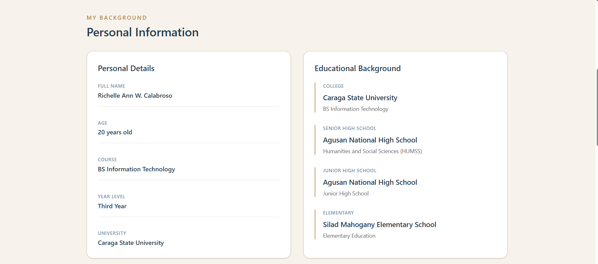
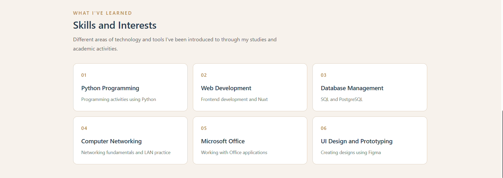
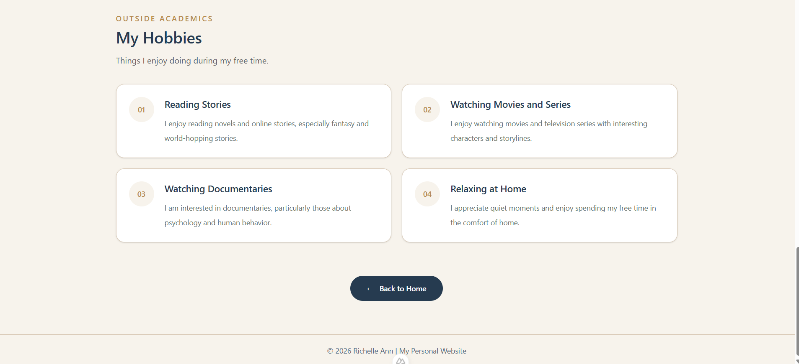

# Calabroso_ITE-18--Activity-1-Frontend

## Personal Profile Website

A two-page personal profile website developed using **Nuxt.js** as part of **ITE 18 – Application Development and Emerging Technologies, Activity 1 – My First Nuxt Application (Frontend)**.

The website serves as a personal introduction, presenting basic information, educational background, skills, interests, and hobbies through a simple and responsive interface.

## Technologies Used

- **Nuxt.js** – Vue-based framework for building the web application
- **Vue.js** – JavaScript framework for building user interfaces
- **TypeScript** – Used for writing the project's scripts with type support
- **Tailwind CSS** – Used for styling and layout
- **HTML** – Used to structure the web page content
- **CSS** – Used for the website's visual styling through Tailwind CSS

## Website Pages

### Page 1 – Home Page

The homepage serves as the main introduction, featuring a welcome messages, and a short personal introduction, and my profile picture.


### Page 2 – Profile Page

The profile page provides more detailed information, including personal information, educational background, skills and interests, and hobbies.








## Project Folder Structure

The project follows the standard Nuxt application structure.


## Installation and Setup

### Prerequisites

Make sure the following are installed on your computer:

- Node.js
- npm
- Git

### 1. Clone the Repository

```bash
git clone https://github.com/calabrosorichelleann-workac/Calabroso_ITE-18--Activity-1-Frontend.git
```

### 2. Navigate to the Project Folder

```bash
cd Calabroso_ITE-18--Activity-1-Frontend
```

### 3. Install Dependencies

```bash
npm install
```

### 4. Run the Development Server

```bash
npm run dev
```

Open your browser and visit:

```text
http://localhost:3000
```

## Source Code

**GitHub Repository:** [Calabroso_ITE-18--Activity-1-Frontend]https://github.com/calabrosorichelleann-workac/Calabroso_ITE-18--Activity-1-Frontend.git

---

## Author

**Richelle Ann W. Calabroso**
BS Information Technology, Third Year
Caraga State University